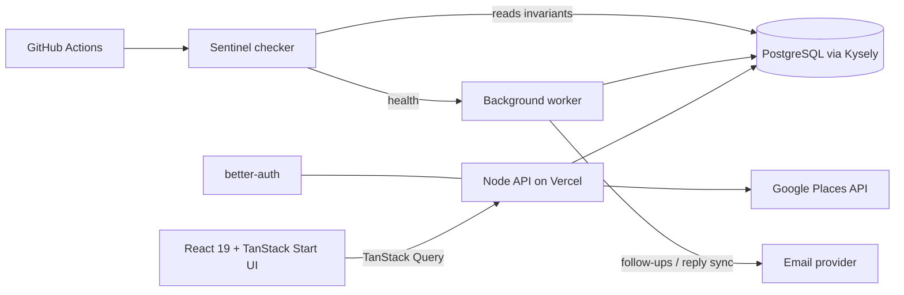
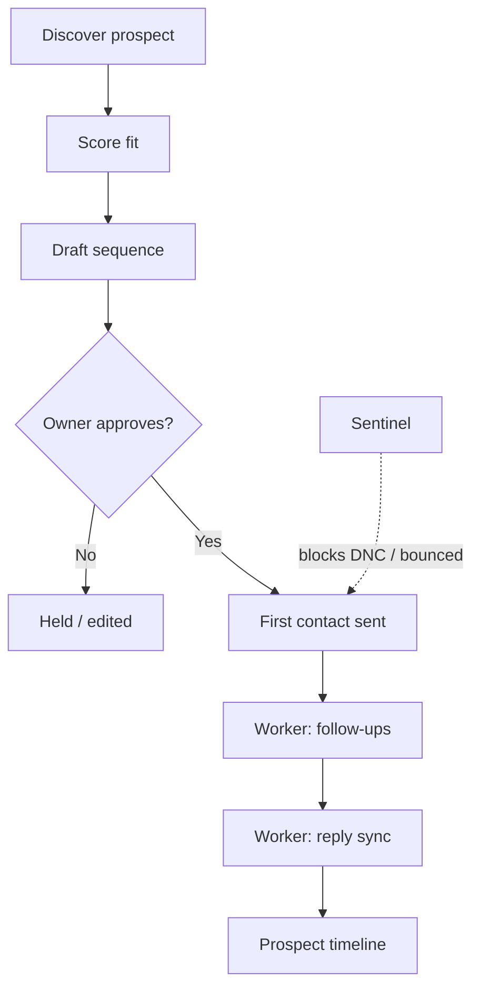

# Lamb Ascension Engine — Showcase

**AI systems for businesses everywhere.**

  

This is the public showcase for the Lamb Ascension Engine, built by [Dylan Lamb](https://www.linkedin.com/in/dylan-lamb-8b9321191/). The production source code is private; this repo holds an overview, the architecture, and a static demo site that uses **sample data only**.

**Live demo:** [dylanlamb19.github.io/lamb-ascension-engine-showcase](https://dylanlamb19.github.io/lamb-ascension-engine-showcase/)

> The production source is private and available on request. A code walkthrough is available too — reach out on [LinkedIn](https://www.linkedin.com/in/dylan-lamb-8b9321191/).

## Overview

Businesses in professional services, software, retail, and other industries need a steady flow of qualified leads, but cold outreach is easy to get wrong. The engine finds prospects, scores how well each one fits, and runs outreach sequences that **require the owner's approval before any first contact**. A background worker handles follow-ups and reply syncing, and a Sentinel layer watches system invariants.

## Features

- **Prospect discovery** — finds businesses by industry through the Google Places API.
- **Fit scoring** — rates each prospect from research data; it never invents revenue, ad-spend, or lead-count figures.
- **Owner-approved outreach** — sequences are drafted and queued, but nothing is sent to a new contact until the owner approves.
- **Background worker** — sends scheduled follow-ups and syncs replies back into each prospect's timeline.
- **Sentinel invariant checker** — inspects do-not-contact rules, bounces, and worker health, and reports problems instead of silently auto-fixing them.
- **CI** — GitHub Actions runs Sentinel checks in CI, on a schedule, and after deploys.

## Architecture

## Outreach approval flow

## Tech stack

| Layer | Tools |
|---|---|
| Language | TypeScript |
| Frontend | React 19, TanStack Start / Router / Query, Vite, Tailwind CSS 4, Radix UI |
| Data | PostgreSQL (`pg`, Kysely), PGlite for local/dev |
| Auth | better-auth |
| Hosting | Vercel |
| CI | GitHub Actions |

## Data model (summary)

- **Prospects** — business identity, industry, location, source (Google Places), fit rating.
- **Sequences & steps** — outreach messages, schedule, approval state.
- **Messages / replies** — sent items and synced replies per prospect.
- **Suppression** — do-not-contact and bounced addresses, enforced before any send.
- **Worker / health records** — run state used by Sentinel.

## How Sentinel works

Sentinel is a read-only invariant layer. It checks that no do-not-contact or bounced address is queued, that the worker is running and healthy, and that data stays consistent. It **reports** violations (in CI, on a schedule, and after deploys) rather than auto-fixing them, so a human decides the fix.

## Engineering highlights

- Spend is reserved in a SQL transaction before any paid provider call, with per-user and app-wide daily caps.
- Every contact field keeps its provenance (verified, found publicly, enriched, owner provided, unknown).
- The worker uses a heartbeat lease so overlapping runs can't double-send.
- CI runs type checking, linting, tests, and a production build on every pull request.

## Demo site

`index.html` + `styles.css` in this repo — a static page explaining the engine. All prospect names and figures shown in it are **fictional sample data**.

## Work with me

I build AI agents and automation tools under the Ascension OS name, and I'm open to remote software engineering roles and automation projects for businesses everywhere. Source code for this project is available on request. See more at [lambascension.com](https://lambascension.com) or reach out on [LinkedIn](https://www.linkedin.com/in/dylan-lamb-8b9321191).

---
© Dylan Lamb · [lambascension.com](https://lambascension.com) · [LinkedIn](https://www.linkedin.com/in/dylan-lamb-8b9321191/) · [Live demo](https://dylanlamb19.github.io/lamb-ascension-engine-showcase/)
